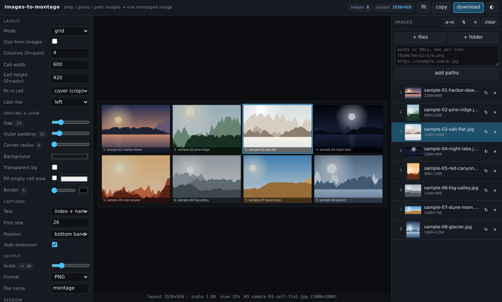
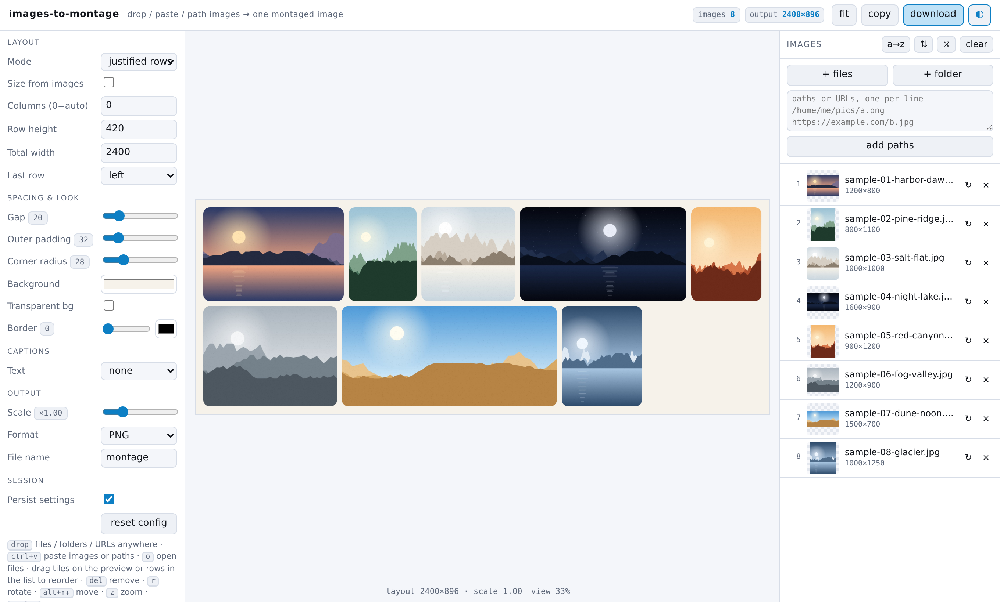
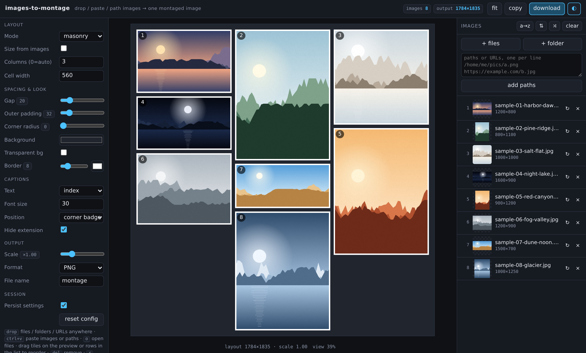
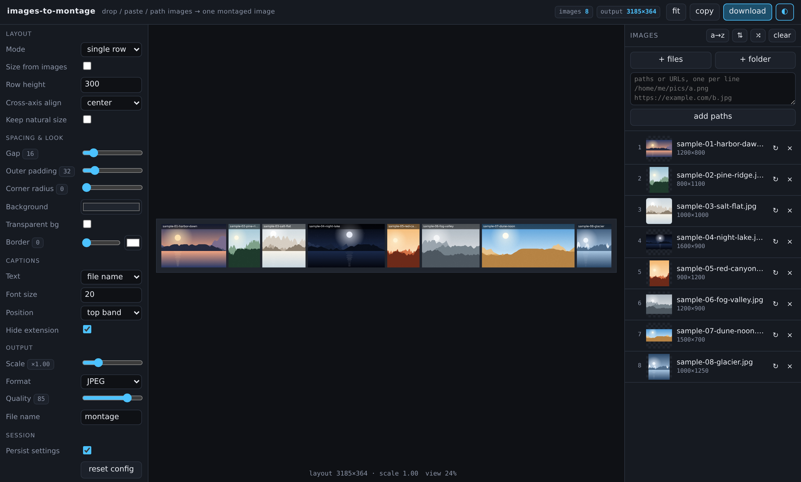
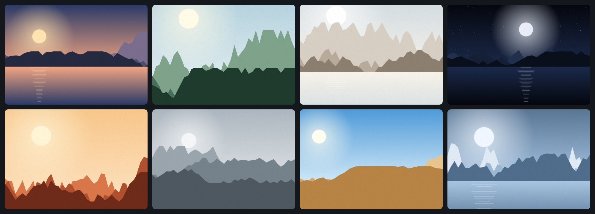
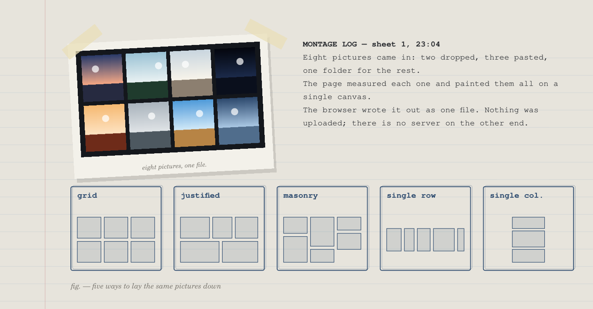
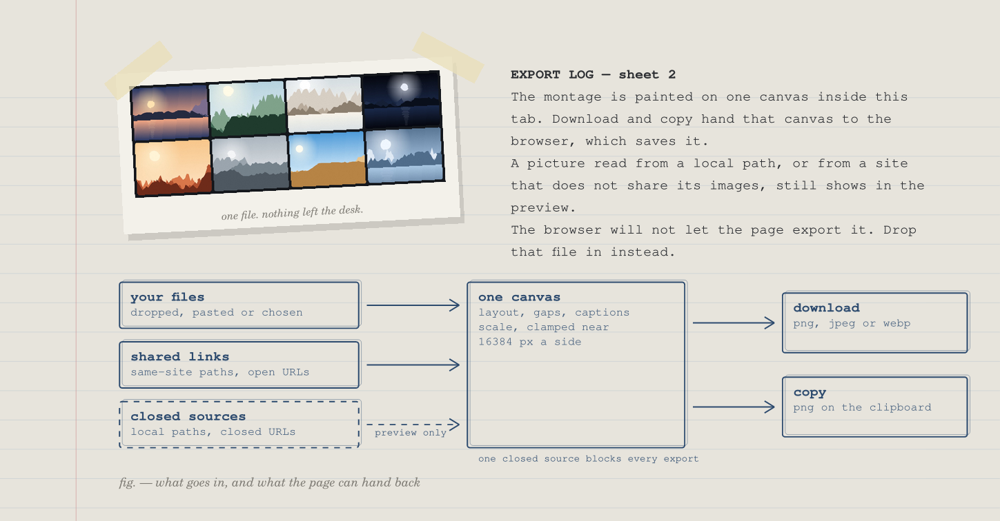

# Images to Montage

Combine many images into one picture, right in your browser. Drop in photos,
screenshots or a whole folder, pick a layout, and download a single montage
as PNG, JPEG or WebP. It works as a photo collage maker, an image grid
generator, a contact sheet builder or a quick way to put screenshots side by
side.

Nothing is uploaded. The page is one HTML file that runs entirely on your
device, with no account and no install, and it keeps working offline.

Open it at <https://html-js.github.io/images-to-montage/>. To try it straight
away with eight sample pictures already loaded, use
[the demo with samples](https://html-js.github.io/images-to-montage/?src=docs/samples/sample-01-harbor-dawn.jpg&src=docs/samples/sample-02-pine-ridge.jpg&src=docs/samples/sample-03-salt-flat.jpg&src=docs/samples/sample-04-night-lake.jpg&src=docs/samples/sample-05-red-canyon.jpg&src=docs/samples/sample-06-fog-valley.jpg&src=docs/samples/sample-07-dune-noon.jpg&src=docs/samples/sample-08-glacier.jpg).



<details>
<summary>More layouts: justified rows, masonry and a single row</summary>

Justified rows on a light page, with rounded corners and no captions:



Masonry columns with white borders and numbered corner badges:



A single row at one shared height, with file names on a top band and JPEG
output selected:



</details>

## What you can make

People use this page to merge images into one file for many everyday jobs.
A photo grid or collage lets you share one image instead of eight. A contact
sheet of a shoot or a folder can carry the file name under each frame.

Screenshots can be stitched side by side or stacked top to bottom for a bug
report or a tutorial. A before and after comparison, a set of design
variants, a product sheet or a mood board all fit on one canvas. It also
helps whenever a slide, a chat or a form accepts only a single picture.

The finished montage is an ordinary image file. Open it in any viewer, attach
it anywhere, or edit it further in your usual tools.

This is the full result exported from the demo above, at 0.8 scale with
rounded corners:



## How to combine images into one

1. Open the page.
2. Add your pictures. Drag them anywhere onto the window, paste them with
   <kbd>Ctrl</kbd>+<kbd>V</kbd>, or use "+ files" or "+ folder" on the right.
3. Choose a layout under "Layout" on the left.
4. Adjust spacing, corners, borders and captions until the preview looks right.
5. Press "download" (or <kbd>Ctrl</kbd>+<kbd>S</kbd>) to save the montage.
   "copy" puts it on the clipboard as PNG instead.

The preview always shows exactly what will be saved. The header tells you the
number of pictures and the pixel size of the output before you export.

## Adding pictures

There are several ways in, and they can be mixed freely.

Drag and drop works anywhere on the window. You can drop single files,
several files, a folder, or an image dragged from another tab. When you drop
a folder, the page walks through its subfolders too and adds every picture
it finds, sorted in natural order so `img2` comes before `img10`.

Paste works for copied images and for screenshots taken to the clipboard.
Pasted screenshots usually have no name, so the page names them after the
local time, such as `pasted-142530.png`. If you paste text instead, each line
is treated as a path or address.

The "+ files" and "+ folder" buttons open your system's file and folder
pickers. Clicking the empty drop area, or pressing <kbd>O</kbd>, does the
same as "+ files".

The box above the list accepts paths and URLs, one per line. Press "add
paths" or <kbd>Ctrl</kbd>+<kbd>Enter</kbd> to load them. Lines starting with
`#` are skipped, and surrounding quotes are removed, so you can paste a list
copied from a terminal or a spreadsheet.

| You type | What the page loads |
| --- | --- |
| `/home/me/pics/a.png` | a file on this computer, as `file://` |
| `C:\Users\me\a.png` | a file on a drive letter, as `file:///C:/...` |
| `\\server\share\a.png` | a file on a network share |
| `file:///...` | used as is |
| `pics/a.png` | a path relative to the page itself |
| `https://example.com/b.jpg` | a picture from the web |

A path starting with `~` cannot be resolved by a browser, so the page asks
for the full path instead.

The page recognizes pictures by type or by extension. PNG, JPEG, GIF, WebP,
AVIF, BMP, SVG and ICO are widely supported. TIFF and others load only where
your browser can display them. An animated GIF or APNG contributes a single
still frame. An SVG without its own size is drawn at 512 by 512 pixels.

### Loading pictures from a link

The page reads `src` parameters from its own address, so a link can open it
with pictures already loaded. Repeat the parameter or separate entries with
`|`:

```
https://html-js.github.io/images-to-montage/?src=docs/samples/sample-01-harbor-dawn.jpg&src=docs/samples/sample-02-pine-ridge.jpg
```

This is handy for sharing a starting point with a teammate, or for a script
that prepares a list of images and opens the page on it.

## Layouts

<details>
<summary>How the five layouts differ (figure)</summary>



</details>

### Grid

Every picture gets a cell of the same size, in rows and columns. Set
"Columns" to a number, or leave it at 0 for an automatic, roughly square
grid. "Cell height" set to 0 picks a height from the typical shape of your
pictures.

"Fit in cell" decides what happens when a picture's shape differs from the
cell. "contain" shows the whole picture with empty space around it. "cover
(crop)" fills the cell and trims the edges. "stretch" fills the cell and
distorts the picture. With "Fill empty cell area" you can color the space
that "contain" leaves behind. "Last row" centers an incomplete final row or
keeps it on the left.

The grid is the classic choice for a photo collage, a contact sheet or an
icon sheet.

### Justified rows

Pictures keep their shape and sit in rows of equal height, and each row is
scaled to fill the "Total width" exactly. This is the gallery look you know
from photo sites, with no cropping and no gaps at the row ends. "Row height"
is the target height before scaling. The last row can stay at that height
on the left, be centered, or stretch to the full width.

### Masonry

Pictures go into a fixed number of columns of equal width, each one placed
in whichever column is currently shortest. Tall and wide shots keep
their proportions and stack at their own heights. It suits mixed sets such
as a mood board.

### Single row and single column

A single row places everything side by side at one shared height, which is
the quickest way to join images horizontally. A single column stacks them at
one shared width, which is how you stitch screenshots vertically into one
long image.

"Cross-axis align" lines pictures up along the top, center or bottom of a
row (left, center or right in a column). Tick "Keep natural size" to skip
the height or width matching and use each picture at its own size.

### Size from images

"Size from images" is on by default. Cell width, cell height, row height and
total width then follow your pictures, so nothing is shrunk below its
original size and fine text in screenshots stays readable. The manual size
fields are greyed out while it is on and show the values in use.

Turn it off to set sizes by hand. The fields start from the values the page
was using, so the preview does not jump. Smaller cells make smaller files,
which helps when the montage only needs to look good in a chat or on a
slide.

## Spacing, borders and captions

The "Spacing & look" group shapes the space around and between pictures.

| Setting | Effect |
| --- | --- |
| Gap | space between pictures, 0 to 120 px |
| Outer padding | margin around the whole montage, 0 to 200 px |
| Corner radius | rounded corners on every picture, 0 to 120 px |
| Background | color behind the pictures and in the gaps |
| Transparent bg | leaves the background see-through in PNG and WebP |
| Border | an outline around each picture, with its own width and color |

JPEG has no transparency, so a JPEG export always uses the background color
even when "Transparent bg" is ticked.

Captions print text onto the pictures themselves. Choose the picture's
number, its file name, or both, then pick a font size and a position: a
band along the bottom, a band along the top, or a rounded badge in the
corner. "Hide extension" drops `.jpg` and the like from names. Long names
are shortened with an ellipsis so they never spill past their picture.

Captions use your system's interface font, so the same montage can look
slightly different on another computer.

## Arranging and editing pictures

The list on the right shows every picture with its number, a thumbnail, its
pixel size and any problem.

You can reorder in three ways. Drag a row in the list to a new place. Drag a
tile in the preview onto another tile to move it there. Or select a picture
and press <kbd>Alt</kbd> with an arrow key.

The buttons above the list sort by name in natural order (a→z), reverse the
order (⇅), shuffle it (⤮), or clear everything. Clearing more than three
pictures asks first.

The ↻ button on a row rotates that picture by 90 degrees; hold
<kbd>Shift</kbd> to turn it the other way. Double-clicking a tile in the
preview also rotates it. The × button removes a picture.

### Keyboard shortcuts

Shortcuts are ignored while you type in a field, apart from saving and
copying.

| Keys | Action |
| --- | --- |
| <kbd>Ctrl</kbd>+<kbd>S</kbd> | download the montage |
| <kbd>Ctrl</kbd>+<kbd>Shift</kbd>+<kbd>C</kbd> | copy the montage as PNG |
| <kbd>Ctrl</kbd>+<kbd>V</kbd> | paste pictures or paths |
| <kbd>O</kbd> | choose files |
| <kbd>Z</kbd> | switch the preview between fit and 1:1 |
| <kbd>T</kbd> | switch light and dark theme |
| <kbd>R</kbd> / <kbd>Shift</kbd>+<kbd>R</kbd> | rotate the selected picture |
| <kbd>Delete</kbd> or <kbd>Backspace</kbd> | remove the selected picture |
| arrow keys | select the previous or next picture |
| <kbd>Alt</kbd>+arrow keys | move the selected picture |
| <kbd>Esc</kbd> | clear the selection |

On a keyboard with <kbd>Cmd</kbd>, it works in place of <kbd>Ctrl</kbd>.

## Export: PNG, JPEG, WebP and clipboard

The "Output" group controls the saved file.

"Scale" multiplies the whole montage from 0.1 to 4 times, so you can export
a small preview for a chat or a large print version from the same layout.
"Format" picks PNG for lossless output and transparency, JPEG for small
photo files, or WebP for small files with optional transparency. JPEG and
WebP show a "Quality" slider. "File name" sets the name of the download.

If your browser cannot encode the chosen format, the page saves whatever
format it did produce and tells you so.

Browsers limit how large a single canvas can be, at roughly 16384 pixels on
a side. If your layout would be larger, the page lowers the scale to fit and
shows a "clamped" chip in the header with the scale it used. Lower the
scale, use fewer columns, or turn off "Size from images" if you need a
different trade-off.

"copy" writes the montage to the clipboard as PNG, ready to paste into a
chat, a document or an image editor. Some browsers do not support images on
the clipboard; use "download" there.

### Why export is sometimes blocked

<details>
<summary>What goes in, and what the page can hand back (figure)</summary>



</details>

A browser only lets a page save pictures that it is allowed to read. Files
you drop, paste or choose are always readable. Pictures loaded from a typed
local path, or from a website that does not share its images with other
sites, still appear in the preview, but the browser refuses to let the page
export them. The header then shows "export blocked" and the list marks
those pictures "no export".

The fix is simple: download or locate those pictures and drop the files onto
the page instead of typing their path. One blocked picture blocks the whole
export, so remove it or replace it before saving.

## Settings, themes and preview

"Persist settings" keeps your layout and output choices in this browser for
next time. "reset config" returns every setting to its default but keeps
your theme. The ◐ button switches between dark and light.

The "fit" button toggles the preview between fitting the window and showing
the montage at one image pixel per screen pixel. The line under the preview
reports the layout size, the scale, the zoom and the selected picture.

On a narrow screen the panels stack vertically, so the page also works on a
tablet or a phone with a file picker.

## Privacy

Your pictures stay on your device. Files you drop, paste or choose are read
into the browser's memory and are released when you remove them or close
the tab. The montage is drawn and encoded locally, and the download is saved
by your browser like any other file.

The page sends no analytics, sets no cookies and loads no fonts, scripts or
styles from elsewhere. It only reaches the network when you give it an
address yourself: a web URL typed into the list, or a link with `src`
parameters. Those addresses are fetched by your browser from the sites you
named, exactly as if you had opened them.

When "Persist settings" is on, the page stores your settings in the
browser's local storage under `images-to-montage.v1`. Pictures, file names
and paths are never stored. Untick the box to remove the saved settings.

A few things are worth knowing before you share a montage:

- Captions print file names into the image. Names can reveal more than you
  expect, such as a person's name, a date or a project.
- The montage is a fresh image drawn from your pictures, so camera details
  and location data embedded in the originals are not copied into it.
- Pasted screenshots are named after the local time of the paste, and that
  name appears in captions if you use them.

## Requirements and offline use

Any current desktop or mobile browser runs the page. It needs JavaScript
and the standard canvas features, and nothing else.

To use it offline, save `index.html` from this repository and open it from
disk. Everything except loading pictures from the web keeps working. You
can also host the single file on any static web server or an intranet page.

To run a local copy that also accepts the `?src=` sample links, clone the
repository and run `make serve`, then open <http://127.0.0.1:8000/>.

## Troubleshooting

### The download button is greyed out

No picture has loaded yet. Check the
list for red entries, which show why a picture failed to load.

### A picture shows "failed to load"

The file may be in a format your
browser cannot display, or the path or address may be wrong. Try opening
it in a new tab to see whether the browser can show it.

### Export says it is blocked

One or more pictures came from a path or a
site the browser will not let the page read. Drop those files instead, as
described above.

### The montage came out smaller than expected

A "clamped" chip means the
layout exceeded the canvas limit and the scale was lowered. Fewer columns,
a smaller scale or manual sizes keep you under the limit.

### Text in screenshots is blurry

Make sure "Size from images" is on, or
that the scale is at least 1, so pictures are not shrunk.

### The settings came back after a reset

"reset config" keeps your theme
by design. Untick "Persist settings" to stop saving altogether.

## Disclaimer

This software is provided as is, without warranty of any kind, as stated in
the [license](./LICENSE). Keep your original pictures. The page only
composes them; it does not back them up or save your work between sessions.

Exported montages are re-encoded images. JPEG and WebP at less than full
quality lose detail, browsers may convert colors from wide-gamut pictures
to standard colors, and very large layouts are scaled down to fit the
browser's canvas limit. Check the result before you rely on it for print,
evidence or archival use.

You are responsible for having the right to use, combine and publish the
pictures you put into a montage, including any people shown in them.
Pictures loaded from websites remain subject to those sites' terms and the
rights of their owners.

The page keeps pictures local by design, but it runs inside your browser,
which is outside this project's control. Extensions, shared computers and
the operating system can still see what is on screen and in memory. Treat
sensitive pictures accordingly.

## Contributing

Bug reports and ideas are welcome; see [CONTRIBUTING.md](./CONTRIBUTING.md)
and the [Code of Conduct](./CODE_OF_CONDUCT.md). Please never attach private
pictures to an issue. For anything that could leak data, use the private
reporting described in [SECURITY.md](./SECURITY.md).

The screenshots, the sample pictures and the example export are produced by
`docs/shot.js`, and the figures come from Typst sources in `docs/figures/`.
`make help` lists the maintainer commands.

## License

Released under the [GNU Affero General Public License v3.0](./LICENSE),
© 2026 Aesthetic Vulpes. The sample pictures in `docs/samples/` are
generated by `docs/shot.js` and are covered by the same license.

## Citation

If you use this tool in your work, please cite it. The metadata is in
[CITATION.cff](./CITATION.cff).

<details>
<summary>BibTeX</summary>

```bibtex
@software{images_to_montage,
  author  = {Aesthetic Vulpes},
  title   = {Images to Montage: combine many images into one picture in the browser},
  year    = {2026},
  version = {0.1.0},
  url     = {https://github.com/html-js/images-to-montage}
}
```

</details>
